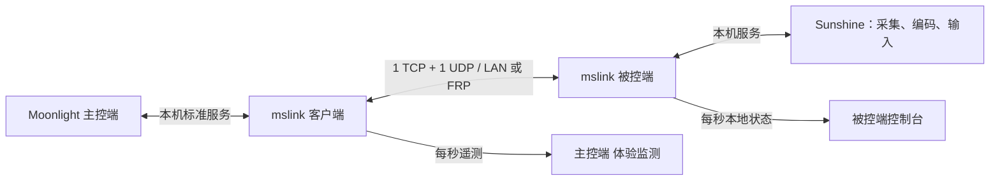

<p align="center"></p>
<h1 align="center">MiniStream</h1>
<p align="center"><strong>让自己的 Windows 游戏主机，连接到另一块屏幕。</strong><br>Windows game & desktop streaming · Powered by jianhx2026</p>
<p align="center">简体中文 · <a href="README_EN.md">English</a> · <a href="https://ministream.jianhx.com/">官网</a> · <a href="https://jianhx189.github.io/jianhx-game-stream/">GitHub Pages</a> · <a href="https://github.com/jianhx189/jianhx-game-stream/releases/latest">下载正式版</a></p>
<p align="center"><a href="https://github.com/jianhx189/jianhx-game-stream/releases/latest"></a> <a href="LICENSE"></a> </p>

MiniStream 基于 **Sunshine + Moonlight-Qt**，为个人游戏与桌面串流提供连接向导、两端原生界面和 **mslink 隧道**：把多路服务复用到 **1 个 TCP + 1 个 UDP 对外端口**，适合端口受限的 FRP 部署。

不需要 MiniStream 云账号。你管理自己的主机、凭据和网络；跨网络需自备可达的 FRP 或可信网络。项目不提供公共服务器，也不等同于自动 NAT 打洞服务。

## v2.2.0 体验与遥测版

- **主控端工作台**：深色重做，侧栏为「我的设备 / 体验监测 / 连接配置 / 串流偏好 / 使用教程」；设备卡片、空状态与小屏折叠沿用。
- **主控端「体验监测」页**：顶部是传输通道标识（`UDP · 低延迟通道`、`TCP · 兼容通道`、`正在探测 UDP`、`等待隧道连接`）和一条经验提示。指标卡为隧道 RTT / 抖动、实际渲染帧率（附接收帧率）、视频码率、发送队列（4 MiB 上限与重连次数）；趋势图可选 **60 秒或 300 秒**窗口，分别画隧道 RTT、下行吞吐（`udp_bytes_down` 差分）和发送队列。
- **媒体与耗时**：视频体验显示网络丢帧、呈现丢帧、分辨率、媒体流 RTT；客户端耗时显示解码、帧排队、渲染、主机处理；另有活动 TCP/UDP 流、本地丢弃、UDP 探测/应答、认证拒绝/回包错误，以及最近 6 条连接事件。
- **被控端四页**：`主机概览`（延迟、帧率、发送速率、丢帧、解码与排队耗时，已认证设备表）、`连接质量`（抖动、流数量、发送队列、重连、本地丢弃、UDP 探测、认证拒绝，四张 1 秒采样趋势图，事件按全部/提示与警告/仅警告筛选）、`媒体会话`（接收与渲染帧率、码率、分辨率、丢帧、解码/排队/渲染/主机处理）、`服务与诊断`（服务启停、端口配置、事件与日志、导出诊断）。
- **指标口径**：隧道 RTT 是心跳往返，**不是端到端操作延迟**；媒体网络丢帧是最终未恢复的帧，**不是 IP 丢包率**；发送队列是隧道内存排队，硬上限 4 MiB。队列 > 1 MiB、丢帧 > 2%、排队 > 30 ms、解码 > 16 ms 只是定位提示阈值，不是体验评分。
- **遥测有界**：隧道在内存中保留最近 **300 个约 1 秒采样点**与 **100 条事件**；同一秒只采样一次，长时间跳变只补一个点；同类别同文案事件 1 秒内去重，单条截断到 163 字节并去换行。实时遥测 JSON 不含历史且小于 64 KiB，历史 JSON 小于 128 KiB；两者都不写盘，状态文件仍约 1 MiB × 2 轮转。缺失或超过 5 秒未更新时显示“—”，**不补演示曲线**。
- **自动测试**：mslink CTest **7/7**（新增 `relay_telemetry`：历史/事件上限、采样节流、JSON 契约、事件不含口令与设备名）。
- **弱网端到端**：真实 `mslink.exe` + 假 Sunshine + 127.0.0.1 上双侧对称的损伤代理（延迟、抖动、丢包、重排、限速、有界队列、中断），7 个场景 **50/50** 检查通过：`baseline`、`rtt100_loss2`、`limit5`、`udp_down`、`recover`、`outage30`、`duplex`。判物理 UDP 只看代理 UDP data 包增量，不用 TCP 字节推断。
- **弱网测试的边界**：单机回环、对称损伤，UDP 回显是自造数据而非 H.264/Opus 媒体，没有 GPU 解码与呈现，不模拟 AQM、IP 分片、MTU、NAT 超时和运营商突发丢包，也不验证 Moonlight 的 FEC/NACK。它证明隧道在受控损伤下的 UDP 保活、回退、恢复与重连行为，**不代表真实跨公网游戏体验**。
- **未执行的验收**：本轮没有运行 Windows 10/11 虚拟机安装（无 Windows ISO，当前会话非管理员；Hyper-V 可用但未创建虚拟机）。**不宣称**干净 Win10/11、所有 GPU/驱动组合或真实长时串流通过。

### 2.1.x 历史

- **2.1.3 回归 → 2.1.4 修复（保留）**：2.1.3 在 `mslink.ini` 不存在时保存主控端连接必定失败，之后每次都要重填；其 `mslink` 启动失败会残留已创建的监听 socket，带 47990 的回退重试可能二次 bind 并卡住首次连接。2.1.4 用 `QSaveFile` 原子创建配置、在失败路径关闭全部 socket 并 `WSACleanup`，同时校验 IPv4 地址，并修复空口令误删凭据、上游失败不发 `StreamClose`。**2.1.3 不建议用于全新安装**；2.1.4 是 2.2.0 之前最后一个已发布版本。
- **保持不变的能力**：2.1.3 引入的隧道加固（4 MiB 发送队列、64 KiB TCP 帧、8 个 pending 握手 / 5 秒超时）、DPAPI 凭据、`--password-stdin`、文件 ACL 与多网卡 UDP 修复在 2.2.0 中继续有效。

DPAPI 只保护“同一 Windows 用户可解”的本地文件，口令在内存中仍是明文，也不保护网络传输；自定义认证与明文会话密钥未变，**不是端到端加密**。遥测与诊断只为定位问题，同一 Windows 用户仍可读取本地状态文件。回退到 2.1.2 及更早版本需要重新填写口令；曾以旧方式分享过隧道或 Sunshine 口令的，建议尽快轮换。

[更新记录](CHANGELOG.md) · [使用与升级](docs/USAGE.md) · [排障指南](docs/TROUBLESHOOTING.md) · [UDP 修复说明](docs/UDP多网卡回包修复说明.md)

## 实际应用界面

| 主控端 | 被控端 |
| --- | --- |
|  |  |


截图为本次 2.2 真实程序窗口，拍摄于主控端未添加设备、被控端等待遥测的离线状态；只展示界面与信息结构，不作为性能承诺，也不会用演示数据填充曲线。

## 三步开始

1. 在运行游戏的电脑安装 [被控端 Host](https://github.com/jianhx189/jianhx-game-stream/releases/latest)，保存自己的隧道口令和 Sunshine 管理信息。
2. 同一局域网填写主机局域网地址；跨网络分别配置 TCP、UDP 转发。默认本机端口为 TCP **14738**、UDP **14739**；公网端口可以不同，主控端填写实际公网端口。
3. 在操作电脑安装 [主控端 Client](https://github.com/jianhx189/jianhx-game-stream/releases/latest)，完成连接向导和配对，打开桌面或游戏。

Sunshine 管理密码用于可选自动配对；未提供时按提示完成手动 PIN 配对。串流中用 `F12` 或 `Ctrl+Alt+Shift+X` 打开菜单，调整鼠标模式、全屏和统计。

用 `Get-FileHash .\MiniStream-Host-Setup.exe -Algorithm SHA256` 校验文件，与同版本 Release 的 `SHA256SUMS.txt` 对照。升级前结束当前串流，在已有安装目录覆盖升级；两端建议使用同一版本。旧式主控端配置可能需要在新向导重新填写：2.1.3 起会把旧明文口令迁移为 DPAPI 密文，回退到旧版本时旧程序读不到口令，需要重新填写。若仍在使用 2.1.3，请覆盖升级到 2.1.4 或更新版本，以修复首次保存失败与启动失败残留 socket 的问题。2.2.0 的客户端、被控端与两份安装包已在本轮构建；下载与校验以 v2.2.0 Release 页面和同版 `release-manifest.json` 为准，不要混装两端版本。

## 连接原理



TCP 处理认证、信令、复用流和可选遥测；UDP 优先承载实时媒体与控制数据。UDP 暂不可用时，逻辑 UDP 数据可通过 TCP 隧道运输，因此 **UDP 字节计数不证明物理 UDP 已通**。端口复用不重新压缩视频，也不保证更低延迟。遥测复用已认证的 TCP 隧道（类型 11，单条上限 8 KiB），不新增公网管理口；历史与事件只驻留内存，不改变落盘的状态文件格式。

## 适用场景

| 需求 | 项目定位 |
| --- | --- |
| 自有 Windows 游戏主机、Sunshine/Moonlight 体验、少量 FRP 端口 | MiniStream |
| 通用远程支持、跨平台协助和远程管理工作流 | 可参考 [RustDesk](https://github.com/rustdesk/rustdesk) |
| Windows 远程登录、办公会话与企业管理集成 | 可参考 [Windows RDP](https://learn.microsoft.com/en-us/windows-server/remote/remote-desktop-services/overview) |

这是定位区别，不是性能排行榜。当前 mslink **只支持一个已认证隧道客户端**；配对设备列表不代表多人同时控制。

## 排障入口

- **面板无数据**：确认实际后台和面板来自同一安装目录，后台已经更新并重启；仅打开新窗口不会升级旧进程。
- **趋势图空着**：趋势来自隧道内存中的 300 个采样点（约 5 分钟）和被控端状态 JSONL 的尾部；刚启动或断线期间没有点，过期（>5 秒）显示“—”。不要用截图或旧日志推断当前曲线。
- **持续 TCP 兼容通道**：检查有效 ACK、会话/认证拒绝和回包源地址。多网卡可导致入包正常、应答失败。[排障指南](docs/TROUBLESHOOTING.md)
- **画面正常但鼠标异常**：记录精确时间、焦点、菜单、鼠标模式和两端版本，不能只凭传输字样判断原因。
- **指标边界**：隧道 RTT 不是端到端操作延迟，媒体丢帧不是 IP 丢包率；提示阈值不是评分。

## 开发与接管

当前主控端是 Moonlight-Qt 覆盖层，**不是仓库早期根 CMake 自研客户端**。从 [开发交接文档](docs/DEVELOPMENT.md) 和 [当前构建指南](docs/BUILD.md) 开始。

```text
src/moonlight-qt/app/   主控端覆盖层：Qt Quick、桥接、输入、统计
src/mslink/            Windows C++17 隧道与 CMake/CTest
src/host-console/      Qt Widgets 被控端控制台
scripts/host/          安装、启动、服务管理脚本
scripts/installer/     Inno Setup 安装包
tools/                 发布与检查工具
docs/                  使用、排障、构建和交接
web/                   静态站点；web/dist 为发布目录
```

Release 提供源码归档、组件来源和构建清单。GitHub 自动源码包主要包含本仓库覆盖层；完整主控端还依赖指定 Moonlight-Qt 基线与子模块。

## 项目状态、贡献与许可

v2.2.0 是本轮的体验与遥测版本：主控端工作台重做并新增体验监测页，被控端控制台扩为四页，遥测历史与事件在内存中有界保留（300 点 / 100 条），mslink 新增 `relay_telemetry` 测试使 CTest 达到 **7/7**，弱网端到端 **7 场景 50/50** 检查通过。这些结果都是**本机单机**结果：弱网测试在 127.0.0.1 上以对称损伤代理驱动真实二进制，回显数据不是游戏媒体，也没有 GPU 解码与呈现；**Windows 10/11 虚拟机验收本轮未执行**（无 ISO、当前会话非管理员，Hyper-V 可用但未建机），因此不宣称干净系统安装、所有 GPU/驱动组合或真实长时串流通过。2.1.3 的首次保存与启动失败回归由 2.1.4 修复，相关说明保留在更新记录中；2.2.0 的最终构建、安装包与哈希以发布清单和 Release 页面为准。

自定义认证和会话密钥传递尚未完成安全审计，不能视为完整的加密 VPN 或零信任接入。2.1.3 起引入并延续到 2.2.0 的 DPAPI 与 ACL 只降低本机文件泄露面：同一 Windows 用户仍可解密，口令在内存中为明文，网络传输的机密性没有改变。遥测与诊断同样只在本机可读，导出后仍需人工脱敏。请在可信、受保护的网络路径部署；曾以旧方式分享过口令的，建议轮换。[安全说明](SECURITY.md)

欢迎提交可复现的 [问题报告](https://github.com/jianhx189/jianhx-game-stream/issues/new/choose) 和改进：[贡献指南](CONTRIBUTING.md)。分享前隐藏凭据、服务器地址、设备标识与转储。

遵循 [GPLv3](LICENSE)。感谢 [Moonlight-Qt](https://github.com/moonlight-stream/moonlight-qt)、[Sunshine](https://github.com/LizardByte/Sunshine)、Qt 与相关上游项目；本项目独立维护。[第三方组件和源码来源](THIRD_PARTY_NOTICES.md)

**Powered by jianhx2026**
