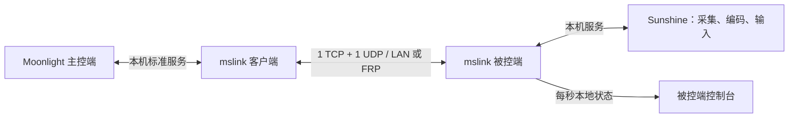

<p align="center"></p>
<h1 align="center">MiniStream</h1>
<p align="center"><strong>让自己的 Windows 游戏主机，连接到另一块屏幕。</strong><br>Windows game & desktop streaming · Powered by jianhx2026</p>
<p align="center">简体中文 · <a href="README_EN.md">English</a> · <a href="https://ministream.jianhx.com/">官网</a> · <a href="https://jianhx189.github.io/jianhx-game-stream/">GitHub Pages</a> · <a href="https://github.com/jianhx189/jianhx-game-stream/releases/latest">下载正式版</a></p>
<p align="center"><a href="https://github.com/jianhx189/jianhx-game-stream/releases/latest"></a> <a href="LICENSE"></a> </p>

MiniStream 基于 **Sunshine + Moonlight-Qt**，为个人游戏与桌面串流提供连接向导、两端原生界面和 **mslink 隧道**：把多路服务复用到 **1 个 TCP + 1 个 UDP 对外端口**，适合端口受限的 FRP 部署。

不需要 MiniStream 云账号。你管理自己的主机、凭据和网络；跨网络需自备可达的 FRP 或可信网络。项目不提供公共服务器，也不等同于自动 NAT 打洞服务。

## v2.1.4 热修复版

- **修复 2.1.3 回归（首次连接）**：主控端在 `mslink.ini` 不存在时保存连接必定失败，之后每次都要重新填写。2.1.4 在配置文件不存在时同样通过 `QSaveFile` 原子创建，保存一次即可保留。
- **修复 2.1.3 回归（启动失败）**：`mslink` 启动失败会泄漏已创建的监听 socket，带 47990 的隧道启动失败后回退重试可能二次 bind 并卡住首次连接。2.1.4 在失败路径完整关闭 socket 并调用 `WSACleanup`，同时校验 listen/bind 地址必须是 IPv4。
- **空口令与上游失败**：空口令会被拒绝且不会删除已保存的 `dpapi:v1:` 密文；上游 Sunshine 目标连不上时主动发送 `StreamClose`，客户端不再一直等到超时。
- **升级提示**：2.1.3 存在上述回归，**不建议用于全新安装**；全新安装请直接使用 2.1.4，已安装 2.1.3 的用户覆盖升级即可，配置与凭据保留。
- **隧道加固（2.1.3 引入）**：每连接发送队列 4 MiB 硬上限、整帧原子入队、失败向上传播；TCP 单帧 64 KiB 上限，`FrameReader` 有界；被控端握手非阻塞（最多 8 个 pending、5 秒超时），仍只保留一个已认证客户端。
- **凭据本地保护（2.1.3 引入）**：主控端连接口令与 Sunshine 口令使用当前 Windows 用户的 DPAPI（`dpapi:v1:`）保存，旧明文 INI 原子迁移；被控端 `mslink` 支持 `--password-stdin`，安装日志不再记录口令，ini / 安装信息 / 日志 ACL 收紧到 SYSTEM、Administrators 与安装用户；新安装口令要求 12–64 字符。
- **双端应用**：主控端设备卡片、在线/配对状态、连接向导、串流菜单；被控端原生控制台、会话、服务、设置与日志。
- **真实状态**：已认证设备、连接时长、传输模式、隧道 RTT/抖动、发送速率与趋势。串流时回传帧率、网络丢帧、解码和排队耗时；缺失或过期数据显示“—”。
- **多网卡 UDP 修复**：通过 Windows `IP_PKTINFO` 保持回包源地址和网卡，解决入包与回包使用不同本机地址而持续回退 TCP 的问题。已在真实转发连接验证恢复 UDP。
- **交互与部署**：原创品牌图标、小屏适配和折叠导航；随包部署 VC143 运行库，安装时按需安装微软 x64 Redistributable。
- **可解释的诊断**：区分监听、认证、UDP 探测和媒体会话；UDP 暂不可用时使用 TCP 兼容通道，并持续探测恢复。

DPAPI 只保护“同一 Windows 用户可解”的本地文件，口令在内存中仍是明文，也不保护网络传输；自定义认证与明文会话密钥未变，**不是端到端加密**。回退到 2.1.2 及更早版本需要重新填写口令；曾以旧方式分享过隧道或 Sunshine 口令的，建议尽快轮换。

[更新记录](CHANGELOG.md) · [使用与升级](docs/USAGE.md) · [UDP 修复说明](docs/UDP多网卡回包修复说明.md)

## 实际应用界面

| 主控端 | 被控端 |
| --- | --- |
|  |  |


截图为 2.1 系列真实程序窗口，拍摄于未连接/未采样状态，不作为性能承诺。

## 三步开始

1. 在运行游戏的电脑安装 [被控端 Host](https://github.com/jianhx189/jianhx-game-stream/releases/download/v2.1.4/MiniStream-Host-Setup.exe)，保存自己的隧道口令和 Sunshine 管理信息。
2. 同一局域网填写主机局域网地址；跨网络分别配置 TCP、UDP 转发。默认本机端口为 TCP **14738**、UDP **14739**；公网端口可以不同，主控端填写实际公网端口。
3. 在操作电脑安装 [主控端 Client](https://github.com/jianhx189/jianhx-game-stream/releases/download/v2.1.4/MiniStream-Client-Setup.exe)，完成连接向导和配对，打开桌面或游戏。

Sunshine 管理密码用于可选自动配对；未提供时按提示完成手动 PIN 配对。串流中用 `F12` 或 `Ctrl+Alt+Shift+X` 打开菜单，调整鼠标模式、全屏和统计。

用 `Get-FileHash .\MiniStream-Host-Setup.exe -Algorithm SHA256` 校验文件，与同版本 Release 的 `SHA256SUMS.txt` 对照。升级前结束当前串流，在已有安装目录覆盖升级；两端建议使用同一版本。旧式主控端配置可能需要在新向导重新填写：2.1.3 起会把旧明文口令迁移为 DPAPI 密文，回退到旧版本时旧程序读不到口令，需要重新填写。若正在使用 2.1.3，请覆盖升级到 2.1.4 以修复首次保存失败与启动失败残留 socket 的问题；全新安装请直接使用 2.1.4。

## 连接原理



TCP 处理认证、信令、复用流和可选遥测；UDP 优先承载实时媒体与控制数据。UDP 暂不可用时，逻辑 UDP 数据可通过 TCP 隧道运输，因此 **UDP 字节计数不证明物理 UDP 已通**。端口复用不重新压缩视频，也不保证更低延迟。

## 适用场景

| 需求 | 项目定位 |
| --- | --- |
| 自有 Windows 游戏主机、Sunshine/Moonlight 体验、少量 FRP 端口 | MiniStream |
| 通用远程支持、跨平台协助和远程管理工作流 | 可参考 [RustDesk](https://github.com/rustdesk/rustdesk) |
| Windows 远程登录、办公会话与企业管理集成 | 可参考 [Windows RDP](https://learn.microsoft.com/en-us/windows-server/remote/remote-desktop-services/overview) |

这是定位区别，不是性能排行榜。当前 mslink **只支持一个已认证隧道客户端**；配对设备列表不代表多人同时控制。

## 排障入口

- **面板无数据**：确认实际后台和面板来自同一安装目录，后台已经更新并重启；仅打开新窗口不会升级旧进程。
- **持续 TCP 兼容通道**：检查有效 ACK、会话/认证拒绝和回包源地址。多网卡可导致入包正常、应答失败。[排障指南](docs/TROUBLESHOOTING.md)
- **画面正常但鼠标异常**：记录精确时间、焦点、菜单、鼠标模式和两端版本，不能只凭传输字样判断原因。
- **指标边界**：隧道 RTT 不是端到端操作延迟，媒体丢帧不是 IP 丢包率。

## 开发与接管

当前主控端是 Moonlight-Qt 覆盖层，**不是仓库早期根 CMake 自研客户端**。从 [开发交接文档](docs/DEVELOPMENT.md) 和 [当前构建指南](docs/BUILD.md) 开始。

```text
src/moonlight-qt/app/   主控端覆盖层：Qt Quick、桥接、输入、统计
src/mslink/            Windows C++17 隧道与 CMake/CTest
src/host-console/      Qt Widgets 被控端控制台
scripts/host/          安装、启动、服务管理脚本
scripts/installer/     Inno Setup 安装包
tools/                 发布与检查工具
docs/                  使用、排障、构建和交接
web/                   静态站点；web/dist 为发布目录
```

Release 提供源码归档、组件来源和构建清单。GitHub 自动源码包主要包含本仓库覆盖层；完整主控端还依赖指定 Moonlight-Qt 基线与子模块。

## 项目状态、贡献与许可

v2.1.4 为热修复发行，修复 2.1.3 的主控端首次保存失败、`mslink` 启动失败残留监听 socket、空口令误删凭据和上游连接失败不发 `StreamClose` 的问题。2.1.3 已在本机验证 CTest 4/4 与 `--password-stdin` 启动实测；2.1.4 新增启动失败重试与上游失败关闭测试（CTest 共六项）并重建全部组件，**最终测试与构建结果以发布清单记录为准，本文不预先宣称 2.1.4 已通过**。**未完成干净 Win10/Win11 安装、所有 GPU/驱动组合、高码率弱网与长期跨网游戏的验收**。体验仍取决于设备、网络与具体游戏。

自定义认证和会话密钥传递尚未完成安全审计，不能视为完整的加密 VPN 或零信任接入。2.1.3 起引入、2.1.4 保持的 DPAPI 与 ACL 只降低本机文件泄露面：同一 Windows 用户仍可解密，口令在内存中为明文，网络传输的机密性没有改变。请在可信、受保护的网络路径部署；曾以旧方式分享过口令的，建议轮换。[安全说明](SECURITY.md)

欢迎提交可复现的 [问题报告](https://github.com/jianhx189/jianhx-game-stream/issues/new/choose) 和改进：[贡献指南](CONTRIBUTING.md)。分享前隐藏凭据、服务器地址、设备标识与转储。

遵循 [GPLv3](LICENSE)。感谢 [Moonlight-Qt](https://github.com/moonlight-stream/moonlight-qt)、[Sunshine](https://github.com/LizardByte/Sunshine)、Qt 与相关上游项目；本项目独立维护。[第三方组件和源码来源](THIRD_PARTY_NOTICES.md)

**Powered by jianhx2026**
