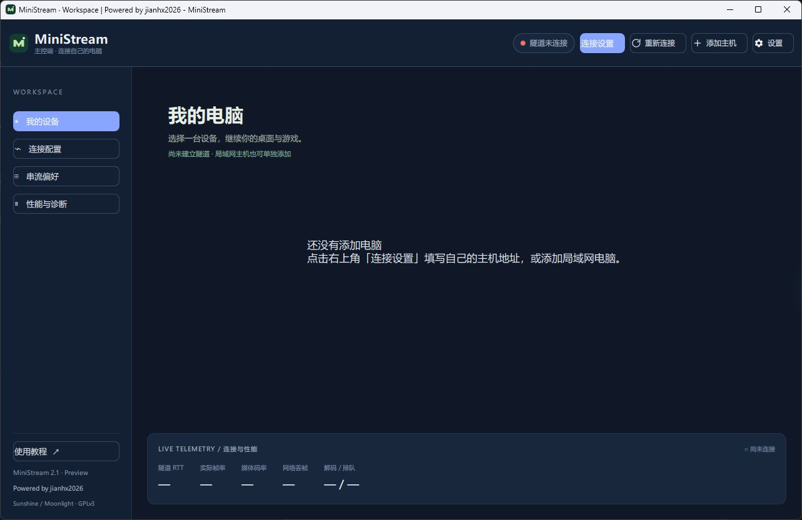
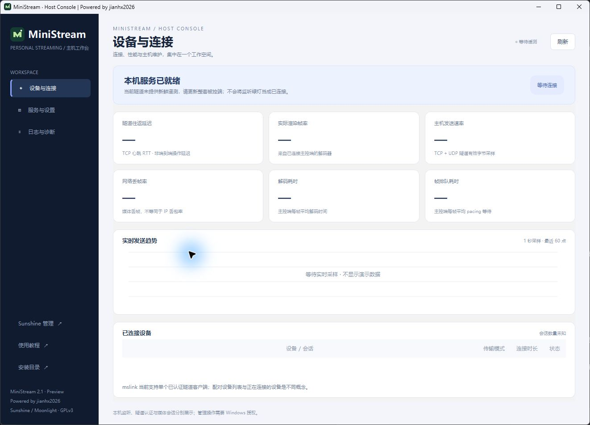
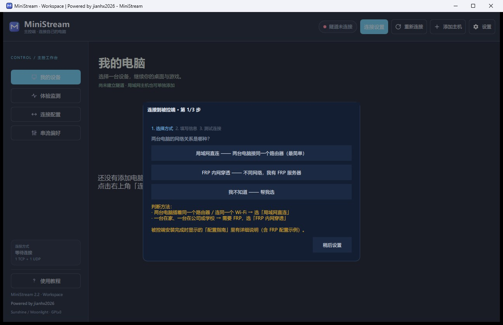

<p align="center"></p>
<h1 align="center">MiniStream</h1>
<p align="center"><strong>Your Windows gaming PC, on another screen.</strong><br>Powered by jianhx2026</p>
<p align="center"><a href="README.md">简体中文</a> · English · <a href="https://ministream.jianhx.com/en.html">Website</a> · <a href="https://jianhx189.github.io/jianhx-game-stream/">GitHub Pages</a> · <a href="https://github.com/jianhx189/jianhx-game-stream/releases/latest">Download</a></p>

MiniStream combines **Sunshine and Moonlight-Qt** with a connection wizard, native applications for both ends, and **mslink**, a Windows tunnel that multiplexes streaming services over **one public TCP port and one public UDP port**. It is designed for your own Windows gaming or desktop PC, including FRP deployments with limited available ports.

No MiniStream cloud account is required. You manage your host, credentials and network. Provide a reachable LAN, FRP deployment or another trusted path; MiniStream does not operate a public relay or provide automatic NAT traversal.

## What's in v2.1.3

- **Tunnel hardening.** Each connection's send queue has a hard 4 MiB cap; a frame is reserved and queued as a whole, and enqueue/overflow failures are returned to the caller instead of silently dropping bytes. TCP frames are capped at 64 KiB and the frame reader stays bounded. The host handshake is non-blocking with at most 8 pending peers and a 5 s timeout, and only one authenticated controller is kept; duplicate copies with `seq == highest` are now counted correctly.
- **Local credential protection.** The controller stores the tunnel and Sunshine passwords with current-user Windows DPAPI (`dpapi:v1:`) and atomically migrates a legacy plaintext INI. The host tunnel accepts `--password-stdin`, the installer passes the password on standard input, install logs no longer record tunnel or Sunshine passwords, and ini/install-info/log ACLs are limited to SYSTEM, Administrators and the installing user. New installs require a 12–64 character tunnel password; existing passwords remain valid.
- **A complete desktop workflow.** Device cards, pairing status, connection wizard and in-session menu on the controller; a native Qt Widgets host console for sessions, services, settings and diagnostics.
- **Actual connection information.** Authenticated device, duration, transport, tunnel RTT/jitter, outgoing throughput and history. Compatible controllers report media frame rate, network frame loss, decoding and frame pacing while streaming. Missing or stale samples appear as a dash.
- **A verified multi-interface UDP fix.** Windows packet information preserves the incoming destination address and interface for HELLO_ACK and media replies. This resolves a reproduced case where replies left another local interface and the application stayed in TCP fallback despite working forwarding.
- **Deployment and usability improvements.** Original branding, small-display layouts, collapsible navigation, app-local VC143 files and detection/installation of the bundled Microsoft x64 Redistributable when needed.
- **Continuity when UDP fails.** Logical UDP traffic can temporarily use the TCP tunnel. Authenticated probing continues so the application can recover after the path becomes available.

DPAPI only protects local files that the same Windows user can decrypt; passwords are still plaintext in memory and network confidentiality is unchanged. The custom authentication and plaintext session key are also unchanged, so mslink is **not end-to-end encrypted**. Downgrading from 2.1.3 to 2.1.2 or earlier requires entering the passwords again, and previously shared tunnel or Sunshine passwords should be rotated.

[Changelog](CHANGELOG.md) · [User guide](docs/USAGE.md) · [Troubleshooting](docs/TROUBLESHOOTING.md)

## The applications

| Controller | Host console |
| --- | --- |
|  |  |



These are real windows from the 2.1 series captured without an active session, not performance benchmarks.

## Get connected

1. Install [Host](https://github.com/jianhx189/jianhx-game-stream/releases/download/v2.1.3/MiniStream-Host-Setup.exe) on the PC running the desktop or game. Keep your tunnel password and Sunshine management details private.
2. On a LAN, use the host's LAN address. Across networks configure separate TCP and UDP forwarding. Default local ports are **TCP 14738 / UDP 14739**; public ports may differ. Enter the actual public ports on the controller.
3. Install [Client](https://github.com/jianhx189/jianhx-game-stream/releases/download/v2.1.3/MiniStream-Client-Setup.exe) on the PC you operate, complete the wizard and pairing, then launch a desktop or application.

Sunshine management credentials enable optional automatic pairing. Otherwise follow the manual PIN flow. During a stream, `F12` or `Ctrl+Alt+Shift+X` opens mouse mode, display, statistics and disconnect controls.

Verify SHA-256 against `SHA256SUMS.txt` from the same release. End active sessions before upgrading. Install over the existing host directory to preserve configuration/pairings and update both ends together. Older controller connections may need to be entered again: 2.1.3 migrates plaintext passwords to DPAPI, which 2.1.2 and earlier cannot read, so a downgrade requires re-entering them.

## How it works

```text
Moonlight ↔ local mslink ↔ 1 TCP + 1 UDP / LAN or FRP ↔ host mslink ↔ Sunshine
                                                            ↓
                                                     host console
```

The tunnel multiplexes services; it does not recompress video. Fewer public ports do not guarantee lower latency. TCP carries authentication, signaling, multiplexed streams and optional telemetry. During fallback, logical UDP data travels over TCP, so a UDP byte counter alone does **not** prove physical UDP reception.

The current tunnel supports **one authenticated controller session** at a time. Paired devices and active sessions are different concepts.

## Where MiniStream fits

MiniStream focuses on personal Windows game/desktop streaming with Sunshine/Moonlight and constrained-port deployments. [RustDesk](https://github.com/rustdesk/rustdesk) addresses broader remote-support workflows; [Windows RDP](https://learn.microsoft.com/en-us/windows-server/remote/remote-desktop-services/overview) focuses on remote Windows sessions and administration. These are differences in purpose, not claims that MiniStream outperforms either product.

## Diagnose a connection

- A listening port is not proof of authentication or public reachability. Opening a new console does not upgrade an old background process.
- For persistent TCP fallback, inspect valid replies, session/authentication rejection, forwarding and reply source endpoints. Multiple adapters can matter even when incoming UDP reaches the host.
- When video works but input stops, record focus, menu state, mouse mode, versions and exact time. The transport label alone does not identify an input failure.
- Tunnel RTT is not end-to-end input latency; media frame loss is not IP packet loss. Stale media samples are intentionally hidden.

## Build and maintain

The release controller is a **Moonlight-Qt overlay**, not the earlier standalone root CMake client. Start with [DEVELOPMENT](docs/DEVELOPMENT.md) and [BUILD](docs/BUILD.md). Sources cover the controller, C++17 Windows tunnel/tests, Qt host console, installer/service scripts and static website.

Release assets include a source bundle and component/build manifest. GitHub's automatic source archive mainly contains this repository's overlay; the complete controller requires the pinned Moonlight baseline and recursive submodules.

## Status, security and contributions

v2.1.3 is a regular release. Locally verified: CTest 4/4 (UDP reply source, queue/frame bounds, handshake integration and tunnel self-test) and the `--password-stdin` startup check, plus the 2.1.2 forwarded-connection UDP result. Clean Windows 10/11 installations, all GPU/driver combinations and high-bitrate weak-network or long-running WAN sessions have **not** been verified; final builds of both applications and the installers are recorded when the release manifest is generated. Quality depends on hardware, network and the application.

The custom authentication and key exchange are not independently audited and must not be treated as an encrypted VPN or zero-trust system. DPAPI and the tightened ACLs only reduce local file exposure: the same Windows user can still decrypt the values, passwords stay plaintext in memory, and traffic is not protected end to end. Use a trusted protected path and rotate passwords that were shared before 2.1.3: [SECURITY](SECURITY.md). Never publish working credentials or unredacted dumps.

Reproducible reports and contributions are welcome: [CONTRIBUTING](CONTRIBUTING.md), [Issues](https://github.com/jianhx189/jianhx-game-stream/issues/new/choose).

Licensed under [GPLv3](LICENSE). Independently maintained, built on [Moonlight-Qt](https://github.com/moonlight-stream/moonlight-qt), [Sunshine](https://github.com/LizardByte/Sunshine), Qt and other upstream work. See [third-party notices and sources](THIRD_PARTY_NOTICES.md).
